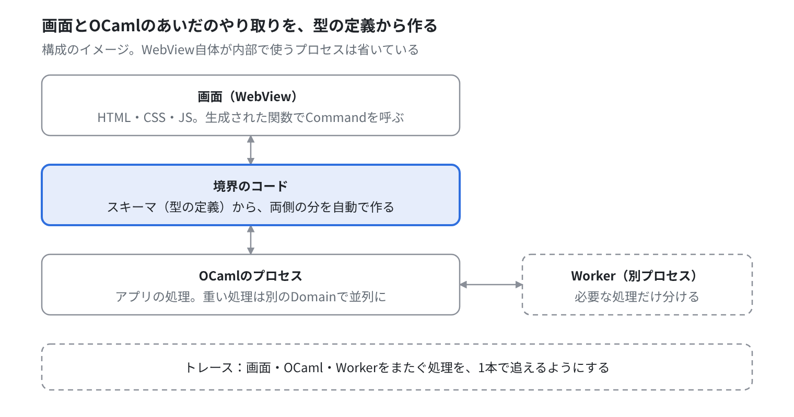
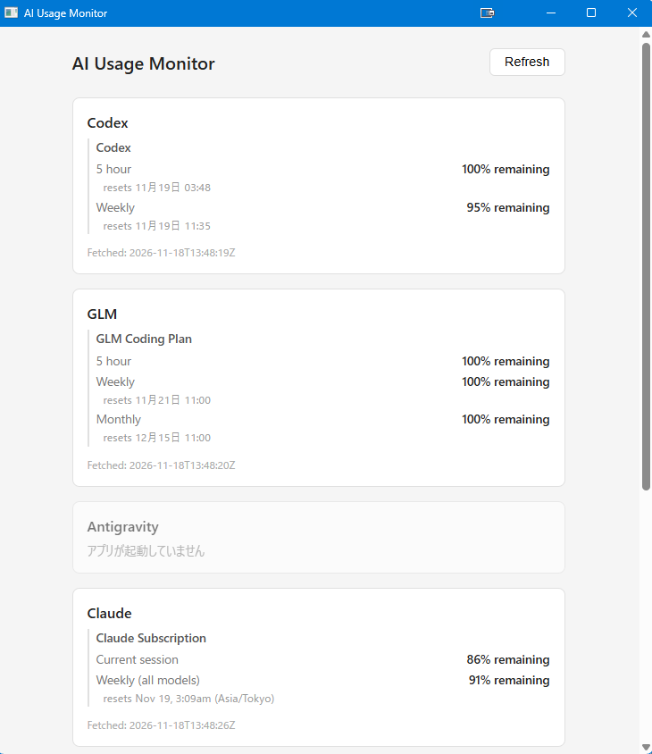

最初に断っておくと、ここで書くOCamlのWebUIランタイムは、まだ人に使ってもらえる状態ではない。[リポジトリは公開している](https://github.com/iwabuchi404/ocaml-webui)が、使い方のドキュメントもほとんどない。OCamlをほとんど書けない自分が、AIと相談しながら設計を決めて、実際に動かして確かめてきた記録として読んでほしい。

## 私とOCaml

OCamlを知ったのは、15年以上前だったと思う。当時はプログラミング言語を調べるのが好きで、使ったことはないけれど名前と特徴だけは知っている言語がたくさんあった。

その中で、関数型言語はよく分からないジャンルだった。HaskellやMLは新しい考え方の言語なんだろうと思いつつ、難しそうで、研究向けで、実際に何かを作るのには向いていないのではないかという印象を持っていた。

OCamlは少し違って見えた。関数型なのにオブジェクト指向も使えて、パフォーマンスにもかなり力が入っている。普通のアプリも作れそうだったし、向いているかは分からないけれど、ゲームなんかも作ってみたいと思った。

10年くらい前に、一度きちんと触ってみようとしたことがある。対話環境でコードを動かすところまではできたが、GUIライブラリの環境構築がうまくいかず、そこで止まってしまった。

その後もOCamlのことは気になっていた。ただ、仕事を言い訳にして時間を取らないまま、もう触ることはないのかなと思っていた。

考えが変わったのは、AIでのコーディングがかなり使えるようになってきたからだ。自分で書けなくても、AIが書いたコードを読みながら進められるなら、もう一度OCamlをやってみてもいいのではないかと思った。

最近はRustがよく話題になる。RustはOCamlの影響を受けた言語だが、自分にとって憧れなのはOCamlのほうで、用途によってはRustより向いている場面もあるのではないかと思っている。これは今の自分の考えで、何かで確かめたわけではない。

## GUIがないなら作る

OCamlとほかの言語を比べた記事を読むと、ほぼ必ずライブラリやコミュニティの少なさが挙がる。せっかく触るなら、OCamlを少しでも使いやすくするものを作りたかった。理想を言えば、自分でも便利に使えて、OCamlを使う人の役にも立つものがいい。

そこで、何を作るかをAIといろいろ相談した。AIは、状態遷移を中心にしたUI、型からUIを生成する仕組み、AIが操作しやすいUIなど、6つの方向を出してきた。どれも理屈は通っていたが、ピンとこなかった。それを作っても、自分がOCamlを使っている姿が想像できなかった。

自分が最初につまずいたのはGUIだった。それなら、WebViewを使ってTauriのようなものを作ればいいのではないか、という話になった。AIは乗り気だった。

## コンセプト

ちょうどその前の月に、OCamlからOS標準のWebViewを使うためのバインディング（[owebview](https://github.com/korkorran/Owebview)）が公開されたばかりで、技術的にはできそうだった。

ただ、Tauriのクローンを作っても意味がないと思った。Tauriは機能が多く、個人で同じものを目指しても、中途半端なものにしかならない気がした。それに、自分で使うだけなら、OCamlで直接アプリを作ればいい。わざわざ土台から作るなら、OCamlで作る意味のあるものにしたい。コンセプトがないなら、作るべきではないと思った。

それでAIに「独自性が無い、気にしなくていい？」と聞いた。

やり取りを続けるうちに、今まで自分が作ってきたものを振り返った。FubakoもKoeNoteもElectronで作っていて、一番面倒だったのは画面ではなく、プロセス間のやり取りだった。

> プロセス間通信が面倒過ぎる、実装もデバッグも

Electronでは、機能を1つ足すたびに、レンダラー側の呼び出し、preloadで公開する関数、IPCのチャンネル名、mainプロセスのハンドラ、引数と戻り値の型を、それぞれ合わせて書く必要がある。どこかで名前や型がずれても、動かしてみるまで分からない。デバッグのときも、レンダラーとmainでログが分かれていて、追いかけるのに手間がかかる。[KamoXの記事](/log/2026-07-12-kamoxelectronvscode/)で書いた「画面では正常に見えるのに、IPCの向こうで失敗している」問題も、根っこは同じだと思う。

そこから、次のような仮説を立てた。デスクトップアプリの開発が重くなるのは、プロセスが分かれていることそのものより、境界をまたぐための決まりきった実装と、デバッグの情報があちこちに散らばることのほうが大きいのではないか。

これは自分が実際に困っている問題で、Electronで同じように困っている人もいると思う。型をしっかり書くOCamlなら、境界の定義を1か所にまとめる作りとも相性が良さそうだった。ここでやっと、OCamlで作る意味がありそうなものが見つかった。

## 設計を自分のサイズにする

方向が決まってから、設計を詰めていった。1人で作るので、できるだけスコープを小さく、自分でコントロールできる形にしたかった。そこで、基本は単一プロセスにすることを考えた（WebView自体は内部で別のプロセスを使うので、ここで言うのはOCaml側の話）。

単一プロセスにする利点と欠点をAIに聞いた。欠点として挙がったのは、一部がクラッシュするとアプリ全体が落ちること、信頼できないコードを分けて動かせないこと、などだった。KoeNoteの音声処理のように、本当に別のプロセスに分けたい処理もある。

結局、普段は単一プロセスで動かし、必要な処理だけをWorkerに分ける形にした。境界をなくすのではなく、境界をまたぐための決まりきったコードだけを自動で作る。独自性として目指すのは、次の3点に絞った。

- OCamlの型付きのCommand定義から、OCaml側とJS側のやり取りのコードを生成する
- JS、OCaml、Workerをまたぐ処理を、1本のトレースとして追えるようにする
- 単一プロセスを基本にして、必要な処理だけを明示的にWorkerへ分ける

作っているものを一言で言うと、画面をHTMLとJSで作り、アプリの処理をOCamlで書くための土台だ。画面からOCamlの処理を呼ぶときのやり取りのコードは、型の定義から自動で作る。重い処理はOCamlの中で別のDomain（並列に動く単位）に回し、落ちやすい処理や別のランタイムが必要な処理だけをWorker（別プロセス）に出す。そのあいだを通る処理は、どこを通っても1本のトレースで追えるようにする。

この時点で、設計文書は31節まで膨らんでいた。権限管理や、大きなデータの受け渡しの仕組みまで書いてあった。これを別のAIにレビューしてもらい、権限管理と大きなデータの章はいったん凍結した。今の段階では、使う場面がまだないからだ。

実装の順番も変えた。自分はOCamlの初心者なので、いきなりコード生成から作るのではなく、なくしたいはずの決まりきったコードを一度手で書いて、それを比較の基準にする。そのあとで、スキーマから生成する版を作って比べることにした。

## 実際に作る中での課題

作り始めて最初にやったのは、分かっているつもりの前提を、実機で一つずつ確かめることだった。知っていることでも、自分の環境で数字にしておかないと、設計の前提にしにくい。以下は7月に、WindowsのWebView2で確かめたことだ。

### UIスレッドを止めても、画面は動いている

OCamlの処理でUIスレッドを3秒止めてみた。別のスレッドからUIスレッドに処理を頼むと、約2.7秒待たされた。それでも、画面のアニメーションは動き続けていた（フレームの間隔は最大23ms）。WebView2の描画は別のプロセスなので当たり前ではあるのだが、見た目ではUIスレッドが止まっているかどうかを判断できない。

そこで、重い処理は別のDomain（OCaml 5の並列実行の単位）で動かし、UIスレッドには結果だけを返す形にした。

### バインディングのクラッシュと、Linuxの制約

途中で、owebviewのネイティブ側のコードで、解放の順番が原因のクラッシュが起きた。ここは手元で直した。低レベルのバインディングを自分で持つことは最初から計画していたが、このクラッシュを見つけてから優先度を上げた。

Linux（WebKitGTK）では、複数のウィンドウを同時に作るとWebKitGTKが落ちた。いったんLinuxではウィンドウを1つに制限し、2つ目を作ろうとすると実行時にエラーを返すようにした。

### 行数は増えたが、手で合わせる場所は減った

同じCommandを、手書きの版と、ATD（スキーマの定義からOCamlとTypeScriptのコードを生成するツール）を使う版で作って比べた。

| 項目 | 手書き版 | ATD版 |
| --- | --- | --- |
| 汎用のbridgeの行数 | 284行 | 400行 |
| Commandを1つ足すときに、手で合わせる場所 | 5か所以上 | 3か所 |
| 型の不一致に気づくタイミング | 主に実行時 | コンパイル時 |

bridgeの行数は、かえって増えた。ただ、Commandを1つ足すたびにあちこち直していた手間は減り、生成した型を使っている範囲では、型のずれにコンパイルの時点で気づけるようになった。減らしたかったのは行数より、人が気をつけて合わせる場所のほうだったので、方向としては合っていたと思う。比べたのはCommand 1つだけなので、数が増えたときにどうなるかはまだ分からない。

### まだ始めたばかり

いろいろ進めてはいるが、まだ始めたばかりで、実用には厳しい状態だ。Tauriより向いていそうな用途で試してみるのは、もっと先の話になる。

## PoC

普段、複数のAIエージェントのツールを使っていて、それぞれの残りの使用量を一目で確認できるツールが欲しかった。それで、動作確認も兼ねて、このランタイムでUsage Monitorを作った。毎日ではないけれど、わりと使っている。

使ってみると、Refreshを押してから全部そろうまでに数秒かかった。サービスを一つずつ順番に問い合わせているからだ。最初はアプリ側でごまかしていたが、アプリごとに対応するよりランタイム側で用意したほうがいいので、非同期のCommandを足した。途中でキャンセルしたり、時間がかかりすぎたら打ち切ったりできる。

認証情報の扱い方がまだ人に見せられる形ではないので、こちらのリポジトリは公開していない。それでも、最低限は実用的に使える段階になっていると思う。

## 今後の予定

7月以降も実装は進めていて、11月の時点で次のものは一通り入っている。これは別の記事で書くつもりだ。

- JS、OCaml、Workerをまたぐトレース
- 外部プロセスのWorkerの管理
- ウィンドウ単位などで、リソースの寿命を管理する仕組み

まだ手をつけていないのは、次のあたりだ。

- JSからOCamlへのイベント通知
- 低レベルのバインディングのAPIを固めるためのレビュー
- Workerを複数動かす仕組み
- 呼ぶたびに起動する外部プロセス向けの仕組み
- WSLではないLinuxと、macOSでの確認

権限管理と大きなデータの受け渡しは、引き続き凍結している。

ゆくゆくは、ほかの人も使えるライブラリとして公開できる状態にしていきたい。今はまだ、自分のアプリで必要になったものを足している段階なので、APIを固めたり、使い方のドキュメントを書いたりするのはその先になると思う。OCamlでデスクトップアプリを作るときの選択肢の一つになれたらいいなと思っている。

10年前はGUIの環境構築で止まったが、今回はそのGUIの部分から作っている。

ocaml-webuiのリポジトリ: [github.com/iwabuchi404/ocaml-webui](https://github.com/iwabuchi404/ocaml-webui)
